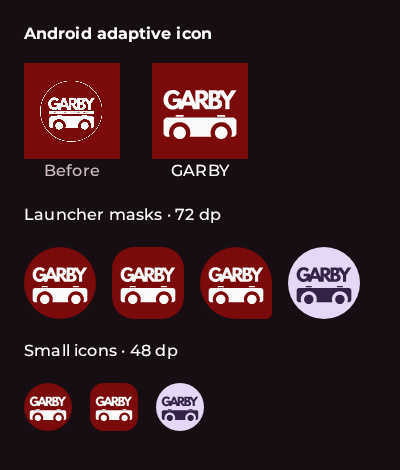

# Most Latest — fullscreen, launcher icon and runtime review

2026-11-14. This follows the [category/divider redesign](2026-11-14-category-redesign.md).

## Fullscreen and icon

Android's status/navigation bars are hidden across the activity and its confirmation
windows. An edge swipe temporarily reveals system controls. The policy is reapplied after
focus returns, including after Home/resume with a dialog open. Existing cutout-safe insets
are retained. The dashboard/return screens and dialog windows were checked on the phone;
the activity policy also covers the start screen without changing authentication.

The launcher now uses a vector traced from the retained official GARBY wordmark and cart.
It removes the print-only ring and tiny tagline rather than shrinking the entire wide
bitmap into a launcher layer. Its 256 vertices lie within a radius of 32.4 dp on Android's
108 dp canvas, inside the guaranteed 33 dp safe radius. The themed layer uses the same
silhouette. The full original artwork and in-app logo remain available unchanged.



The top row is rendered from the actual adaptive resources; the lower rows exercise
circle, rounded-square, asymmetric and themed masks at 72/48 dp. Icon layout was verified
in the native renderer, not across every physical launcher.

## Backend and runtime findings

The observed phone installation was **DEBUGGABLE** and **TEST_ONLY**, consistent with an
Android Studio debug deployment. It used about 150 MiB PSS in the first observation. Saved
frame history showed heavy UI-thread jank, while GPU time was much lower. Firebase and the
app's background threads were sleeping at the idle observations; those samples do not
rule out bursts or establish server latency.

The source audit confirmed narrow Firebase subscriptions, shared connection/status
listeners, conflation before decoding, duplicate suppression and listener detachment on
stop. Existing tests cover sharing, replay expiry, failure propagation and a 1,000-update
burst. No polling loop, additional thread pool or database schema rewrite was added.

Return readiness/progress combination and return server-response handling now run on the
existing bounded background dispatcher. `SavedStateHandle` and visible submission-state
updates remain on the main dispatcher. Firebase Tasks suspend while waiting. Existing
server readiness checks, command fields, freshness deadlines and robot behavior remain.

## On-phone comparison

The user approved installing the verified optimized APK and measuring scrolling/fullscreen/
Home-resume. `adb install -r` retained app data; the cloud session reconnected. Package flags
confirm the final installation is neither debuggable nor test-only. The installed APK
SHA-256 matched the built APK before and after the measured sequence and after UI checks:

```text
25cd2d13511b1c6eaf74fd05441219e733525733ce60f21fc3a027e0498d63a2
```

Both samples used three upward and three downward 400 ms swipes at x=360, y=1170/450, with
250 ms pauses on the same 720×1600 phone. The script checks foreground state before every
gesture; it rejects optimized samples if package flags or APK identity do not match.

| Metric | Installed debug build | Verified optimized build |
| --- | ---: | ---: |
| Recorded frames | 156 | 280 |
| Janky frames | 89 (57.1%) | 56 (20.0%) |
| Median frame time | 32 ms | 23 ms |
| 90th percentile | 81 ms | 36 ms |
| 99th percentile | 113 ms | 48 ms |
| Slow UI-thread frames | 86 | 18 |
| Process PSS | 156,963 KiB (153.3 MiB) | 62,540 KiB (61.1 MiB) |

This comparison includes switching debug to optimized code and the fullscreen/background
changes; it does not isolate their individual contributions. Some jank remains, and only
one physical phone was measured. No 60 fps or device-wide performance guarantee is claimed.

The first attempted optimized sample was invalidated because a different 23 MB debug APK
was redeployed during the test. Its files are marked `invalidated-*` and excluded from this
comparison. A second installation and APK-hash guards established the final results above.
Keep Android Studio on `benchmark` for daily use/performance checks; Run with `debug` will
replace the optimized installation again.

Phone checks also confirmed:

- Both bars hidden and the activity frame occupying 720×1600.
- Hidden bars on confirmation open, after ordinary Home/resume, and after Home/resume with
  the confirmation still open. The confirmation was cancelled; no sign-out occurred.
- Temporary status/navigation controls after a bottom-edge swipe.
- Return-screen open/back and its disabled send button with the current stale robot report.
- No robot return command, firmware upload, Pi deployment or app-data clearing occurred.

## Changed files

| File | Purpose |
| --- | --- |
| [MainActivity.kt](../app/src/main/java/com/thesis/garby/MainActivity.kt), [Fullscreen.kt](../app/src/main/java/com/thesis/garby/ui/Fullscreen.kt) | Shared immersive policy and focus restoration |
| [GlassKit.kt](../app/src/main/java/com/thesis/garby/ui/glass/GlassKit.kt) | Dialog-window policy, disposable focus listener and safe insets |
| [ReturnViewModel.kt](../app/src/main/java/com/thesis/garby/ReturnViewModel.kt) | Background transformations/server handling; main-thread saved state |
| [Launcher foreground](../app/src/main/res/drawable/ic_launcher_foreground.xml), [monochrome layer](../app/src/main/res/drawable/ic_launcher_monochrome.xml) | Centered vector and consistent themed mark |
| [generate_launcher_mark.py](../design/generate_launcher_mark.py) | Reproducible native vector from the existing artwork; Python + Pillow |
| [app/build.gradle.kts](../app/build.gradle.kts) | Internal upgrade ordering; display name remains Most Latest |
| [README.md](../README.md), [SYSTEM_ARCHITECTURE.md](../SYSTEM_ARCHITECTURE.md), [PATCH_NOTES.md](../PATCH_NOTES.md) | Usage, implementation and release notes |
| This report and [verification files](verification/2026-11-14-app-polish/) | Exact checks, raw metrics, screenshots, fixtures and hashes |

The exact current task manifest and SHA-256 hashes are in
[summary.json](verification/2026-11-14-app-polish/summary.json). Earlier category changes
and their dated evidence remain in the preceding report.

## Verification and deployment

All **53 unit tests** passed with zero failures/skips. Debug, R8-minified unsigned release
and signed optimized builds passed. Lint reports no issues. The static check passed for
31 Kotlin files and three bundled fonts. Native preview generation and geometric icon
validation passed. APK signing and package metadata were verified.

The tested optimized APK is installed on the phone. Release artifacts include that exact
APK, an unsigned release output for external production signing, and SHA-256 checksums.
The installable APK uses the existing local development certificate; no key is published.

**MCU upload requirement: None. Pi deployment requirement: None.** Only Android and its
supporting artwork/docs changed. No MCU was uploaded or robot commanded in this task;
installed firmware identity and robot physical acceptance remain unknown.
